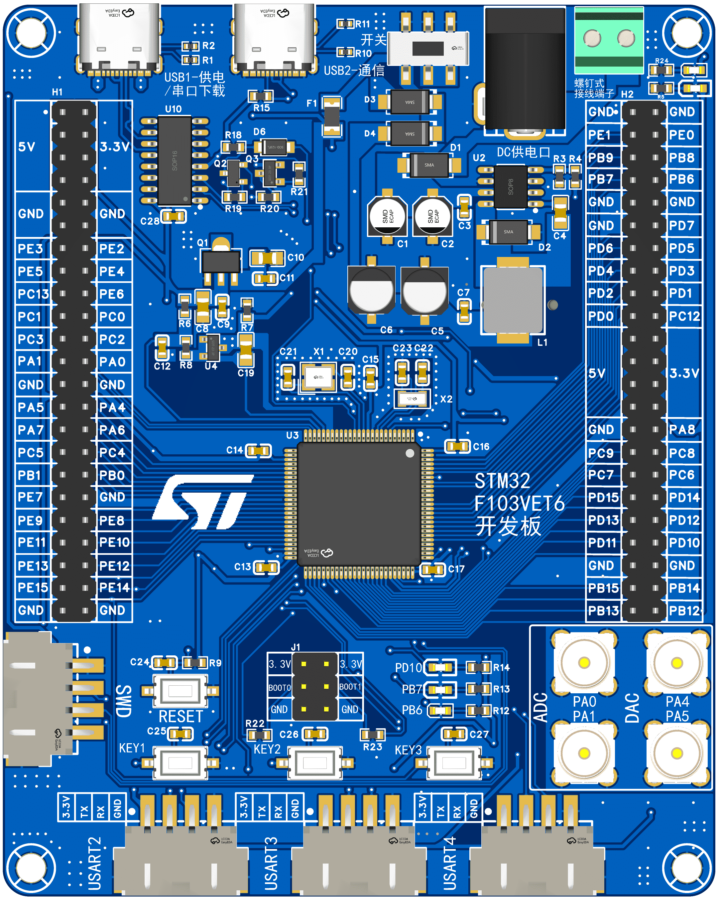
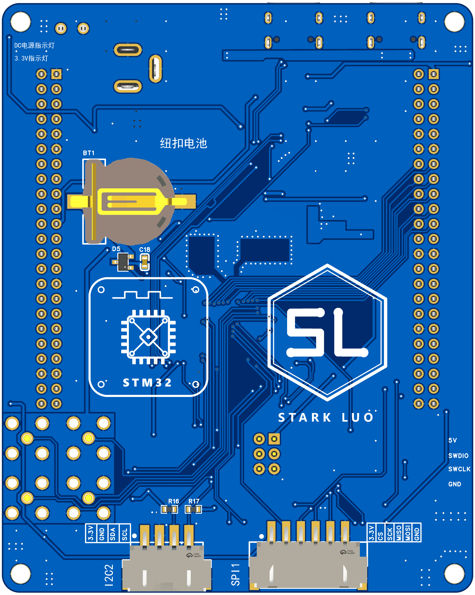

# STM32F103VET6开发板使用手册

| 项目 | 内容 |
| --- | --- |
| 板卡名称 | STM32F103VET6 开发板 |
| 版本 | V1.0 |
| 尺寸 | A4（约 210 × 297 mm） |
| 设计 | STARK LUO（SL） |
| EDA | 嘉立创 EDA（LCEDA Pro） |
| 创建/更新 | 2026-09-21 / 2026-09-25 |

---

## 0. 项目声明

本开发板参考了**Expert电子实验室**的stm32电赛开发板进行设计

[stm32电赛单片机开发板 - 立创开源硬件平台](https://oshwhub.com/expert/stm32-dian-sai-dan-pian-ji-kai-fa-ban?jspm=hub.zy.zp.gc5___hub.ss.lb.yh&jlc_vid=RQUKVFACR1ULUVdQE1hYBFEDRFkNAQdXQ1YMUVMFTgcxVlNfR1VXVVZSTlJZVjsOAxUeFF5JWA4dDxMOAgNABAsLWAQWFwgJBQQxCBcOAAkbBUoFGAw%3D)

开源协议：GPL 3.0

## 1. 概述

本开发板以 **STM32F103VET6**（LQFP100，Cortex-M3，72 MHz，512 KB Flash / 64 KB SRAM）为核心，板载完整的最小系统、多路电源输入与转换、USB 转串口自动下载、以及丰富的外设接口，适合学习、评估与项目原型开发。

板载主要资源：

- STM32F103VET6 主控（LQFP100）+ 8 MHz 主晶振 + 32.768 kHz RTC 晶振
- 电源系统：DC 12 V / 螺钉端子 12 V / Type-C 5 V 多路输入，DCDC + LDO 双级转换，输出 +5 V 与 +3.3 V
- 板载 CH340C USB 转串口，支持 **USB 一键自动 ISP 下载**（自动控制 BOOT0/RST）
- 2 × Type-C 接口（1 路供电 + 下载，1 路与 MCU 直连通信）
- ADC / DAC 模拟 SMA 接口各 2 路（ADC：PA0/PA1；DAC：PA4/PA5）
- SPI（6P）、I2C（4P）、3 路 UART（4P）、SWD（4P）等外设排针
- 3 个用户 LED、3 个用户按键、1 个复位按键
- 2 × 23P（2.54 mm）GPIO 全引出排针
- BOOT0 / BOOT1 启动模式选择、CR1220 纽扣电池（VBAT）、TL431 精密基准（VREF+）
- 4 × M3 固定螺丝孔



<center>正面<center>



<center>背面<center>

---

## 2. 规格参数

| 参数 | 说明 |
| --- | --- |
| 主控 MCU | STM32F103VET6，LQFP100，Cortex-M3 @ 72 MHz |
| 存储 | 512 KB Flash，64 KB SRAM |
| ADC | 3 × 12 位 ADC（最高 21 通道） |
| DAC | 2 × 12 位 DAC（DAC_OUT1 = PA4，DAC_OUT2 = PA5） |
| 主晶振 | 8 MHz 无源晶振（X1） |
| RTC 晶振 | 32.768 kHz（X2） |
| 供电输入 | DC 5.5×2.1 电源座（DC1）、3.81 mm 螺钉端子（CN1）、Type-C（USB1/USB2） |
| 输入电压 | DC 输入 7–36 V（推荐 12 V）；Type-C 5 V |
| 电源输出 | +5 V（DCDC/LDO 前级）、+3.3 V（LDO 后级） |
| DCDC | TPS5450DDAR（U2），12 V → 5 V，最大 5 A |
| LDO | AMS1117-3.3（U1），5 V → 3.3 V |
| USB 转串口 | CH340C（U10），支持自动 ISP 下载 |
| 工作温度 | -40 ℃ ~ +85 ℃（器件等级，实际以整板为准） |

---

## 3. 系统框图

### 3.1 电源树

```
              ┌──────────────┐
  DC 接口 ────┤              │
  (DC1)       │              │
              │              │            ┌──────────┐   +5V   ┌──────────┐
  螺钉端子 ───┤   +12V       ├──────────► │ DCDC芯片  ├───────►│ 电源合路  ├──┬──► +5V ──► LDO芯片 ──► +3.3V
  (CN1)       │              │            │ TPS5450  │        └──────────┘  │
              │              │            └──────────┘                      │
  Type-C ─────┤   +5V        ├──────────────────────────────────────────────┘
  (USB1/2)    └──────────────┘
```

- **+12 V**：由 DC 电源座或螺钉端子输入的 12 V，送入 DCDC。
- **+5 V**：DCDC 输出的 5 V 与 Type-C 的 5 V 经"电源合路"（SS54 肖特基二极管或合，防倒灌）汇合，作为系统 5 V 母线。
- **+3.3 V**：系统 5 V 经 AMS1117-3.3 降压得到，为 MCU 与数字逻辑供电。
- **VDDA**：3.3 V 经"模数隔离"网络（磁珠/0 Ω + 去耦电容）单独供给 MCU 模拟电源，降低数字噪声。

### 3.2 功能分区（原理图页）

| 页 | 内容 |
| --- | --- |
| 第 1 页 主控 | 单片机电路、晶振、复位、BOOT |
| 第 2 页 电源 | DCDC、Type-C、电源合并、LDO、模数隔离 |
| 第 3 页 接口 | USB、ADC/DAC、SPI、I2C、UART、串口自动下载、LED、按键、SWD、螺丝孔 |

---

## 4. 电源系统

### 4.1 输入接口

| 位号 | 接口 | 说明 |
| --- | --- | --- |
| DC1 | DC-005 电源座 | 圆孔 DC 输入，建议 12 V |
| CN1 | MX128L-3.81 两位螺钉端子 | 接线式 12 V 输入，方便接实验电源 |
| USB1 | Type-C | 供电 + CH340C 串口下载 |
| USB2 | Type-C | 与 MCU 直连的 USB 通信口 |

### 4.2 DCDC 电路

- 输入 12 V → 防反接二极管 **D1（SS54）** → 保险丝 **F1（BSMD1206-100-24V）** → **U2 TPS5450DDAR** 降压。
- 外围：L1（15 µH）储能电感，D3（SS54）续流，C5/C6（47 µF）输出滤波，C1/C2（4.7 µF）输入滤波，C3（100 nF）、C4（10 nF）。
- 反馈网络：R4（10 kΩ）/ R3（3.16 kΩ），输出约 **5.08 V**。
- 输出端带 **+5 V 指示灯**（经 R5 限流）。

> TPS5450 输入范围最高 36 V，输出最大 5 A，本板设定为 5 V 输出。

### 4.3 电源合路

- Type-C 的 5 V 与 DCDC 的 5 V 通过两颗 **SS54 肖特基二极管（D2、D4）** 做"或"合并，得到系统 +5 V，避免两路电源相互倒灌。
- 合并后经滤波送至 LDO 与 5 V 排针。

### 4.4 LDO 电路

- **U1 AMS1117-3.3**：+5 V 输入 → +3.3 V 输出，输入/输出端各配 10 µF（C8）+ 100 nF（C9、C7）去耦。
- 输出端带 **+3.3 V 指示灯**。

### 4.5 模数隔离

- +3.3 V 经隔离/滤波网络（磁珠或 0 Ω）生成 **VDDA**，并配 C29、C30（100 nF）等去耦，供 MCU 的 VDDA/VREF 使用，减小 ADC 噪声。

### 4.6 电源指示灯

- 板载 2 个电源指示灯：**DC/+5 V 指示灯** 与 **3.3 V 指示灯**（位于板卡一角，丝印标注）。
- 另在 LDO/DCDC 输出侧各有限流电阻（R5、R6 等，1 kΩ）。

---

## 5. 主控最小系统

### 5.1 MCU

- **U3 STM32F103VET6**，LQFP100。
- 电源去耦：C13–C17 等 100 nF（每对 VDD/VSS 就近放置）。
- 模拟电源：VDDA 由模数隔离网络提供；**VREF+ 由 U4 TL431 可调精密基准**提供（配合电阻分压与 C18/C19 滤波），可获得比 VDDA 更稳定的 ADC 参考电压。

### 5.2 晶振

| 位号 | 频率 | 负载电容 | 用途 |
| --- | --- | --- | --- |
| X1 | 8 MHz | C20 / C21 = 20 pF | 主时钟（HSE，OSC_IN/OSC_OUT） |
| X2 | 32.768 kHz | C22 / C23 = 15 pF | RTC（LSE，OSC32_IN/OSC32_OUT） |

### 5.3 复位电路

- **NRST**：10 kΩ 上拉 + 100 nF（C24）对地滤波 + 复位按键（TS-1101-C-W），按键按下将 NRST 拉低复位。

### 5.4 启动模式（BOOT）

**J1（2×3P 排针）** 用于选择 BOOT0 / BOOT1，板上丝印含 3.3 V / BOOT0 / BOOT1 / GND。R22、R23（10 kΩ）为下拉。

| BOOT1 | BOOT0 | 启动模式 | 说明 |
| :---: | :---: | --- | --- |
| × | 0 | Main Flash memory | 从 Flash 启动（正常工作） |
| 0 | 1 | System memory | 从系统存储器启动（串口 ISP 下载） |
| 1 | 1 | Embedded SRAM | 从内置 SRAM 启动 |

> 注：板载 CH340C 自动下载电路会在下载时自动控制 BOOT0 与 NRST，通常无需手动拨动跳线。

### 5.5 后备电池（VBAT）

- **BT1 CR1220** 纽扣电池 → 经双二极管 **D5（BAT54C）** 与 3.3 V 汇合供给 VBAT，主电源掉电时维持 RTC/备份寄存器；配 100 nF（C18）去耦。

---

## 6. 接口说明

### 6.1 USB 接口

| 位号 | 丝印 | 说明 |
| --- | --- | --- |
| USB1 | 供电/串口下载 | 供电 + 经 CH340C 转串口，支持一键 ISP 下载 |
| USB2 | 通信 | Type-C D+/D- 经电阻（R12/R13）连接到 MCU 的 USB_DP(PA12)/USB_DM(PA11) |

- Type-C CC 配置电阻 5.1 kΩ（R10、R11 等）。
- USB2 数据线经电阻连接到 `USB_DP(PA12)` / `USB_DM(PA11)`，其中 USB_DP 上有 **R15（1.5 kΩ）上拉**（全速设备识别）。
- USB2 可用于 MCU 内置 USB 从机（Device）功能实验。

### 6.2 串口自动下载电路（CH340C）

- **U10 CH340C**：USB 转 TTL 串口，与 MCU 的 **USART1（PA9/PA10）** 相连。
- USB 的 DTR/RTS 经 **Q2（S8550）+ D6（1N4007W）+ R18/R19/R20/R21** 组成自动控制电路，自动拉低/释放 BOOT0 与 NRST，实现 **STM32CubeProgrammer / FlyMcu 等工具的"一键下载"**。
- 板上丝印给出 BOOT 启动模式对照表（同 5.4）。

> 首次使用需安装 CH340 驱动（CH341SER）。

### 6.3 SWD 下载调试

- **CN2（LAIL-PH2.54-4P）**：`GND / SWCLK / SWDIO / VCC+5V`（板卡背面丝印 SWDIO、SWCLK）。
- 信号：SWDIO = PA13，SWCLK = PA14；可接 ST-Link / J-Link，使用 STM32CubeIDE、Keil MDK 或 OpenOCD 调试烧录。
- 调试器只需连接 `GND / SWCLK / SWDIO` 三线即可（调试器自身供电时可不接 5V）。

### 6.4 UART 接口

- 除 USART1 被板载 CH340C 占用外，另引出 **3 路 UART 排针**（板卡丝印 USART2 / USART3 / USART4），每组为 **3.3 V / TX / RX / GND**（4P）。
- 对应接口位号：CN6 = USART2、CN3 = USART3、CN5 = USART4（LAIL-PH2.54-4P）。

| MCU 外设 | 引脚 | 接口/备注 |
| --- | --- | --- |
| USART1 | PA9 / PA10 | 板载 CH340C 下载口 |
| USART2 | PA2 / PA3 | CN6 引出排针 |
| USART3 | **PD8 / PD9** | CN3 引出排针（**USART3 完全重映射**，使用前需使能 AFIO 重映射） |
| UART4 | PC10 / PC11 | CN5 引出排针（对应板卡丝印 USART4） |

> 注意：USART3 使用的是**完全重映射（Full Remap）引脚 PD8/PD9**，与 I2C2（PB10/PB11）**没有冲突**；初始化时需配置 `AFIO_MAPR` 的 `USART3_REMAP = 11`（HAL 中调用 `__HAL_AFIO_REMAP_USART3_ENABLE()` 并设为完全重映射）。

### 6.5 SPI 接口

- **U9（HX 2.54-6P）**，板卡背面丝印 **SPI1**：3.3 V / CS / SCK / MISO / MOSI / GND。
- 信号（**SPI1 重映射引脚**）：SPI1_CS = PA15，SPI1_SCK = **PB3**，SPI1_MISO = **PB4**，SPI1_MOSI = **PB5**。
- 注意：PB3、PB4 复位后默认为 JTAG 的 JTDO / NJTRST，使用 SPI1 重映射前需关闭 JTAG（保留 SWD 即可），否则这两个引脚无法用作 SPI。

### 6.6 I2C 接口

- **CN4（LAIL-PH2.54-4P）**，板卡背面丝印 **I2C2**：3.3 V / GND / SDA / SCL。
- 信号：I2C2_SCL = PB10，I2C2_SDA = PB11；板载 **R16、R17（4.7 kΩ）上拉**。

### 6.7 ADC 接口（SMA）

| 位号 | 连接到 | 丝印 |
| --- | --- | --- |
| U5 | PA0（ADC12_IN0） | ADC |
| U6 | PA1（ADC12_IN1） | ADC |

- 采用 **HL-SMA-KE-02** 射频同轴座，便于接信号源/探头，适合高精度模拟采集实验。

### 6.8 模拟输出 / DAC 接口（SMA）

| 位号 | 连接到 | 丝印 |
| --- | --- | --- |
| U7 | PA4（DAC_OUT1） | DAC |
| U8 | PA5（DAC_OUT2） | DAC |

> **说明**：STM32F103VET6 内置 **2 路 12 位 DAC**（DAC1_OUT = PA4，DAC2_OUT = PA5），本板将两路模拟输出直接引至 SMA 座，可直接输出 0 ~ VREF+ 的模拟电压，无需外加 DAC 芯片。

### 6.9 LED

| 位号 | 颜色 | 连接 | 限流 |
| --- | --- | --- | --- |
| LED5 | 红（SZYY0603R） | PB6 | R12（1 kΩ） |
| LED2 | 绿（SZYY0603G） | PB7 | R13（1 kΩ） |
| LED4 | 蓝（SZYY0603B） | PD10 | R14（1 kΩ） |
| LED1 / LED3 | 红 | +5 V / +3.3 V 电源指示 | R5 / R6（1 kΩ） |

- 用户 LED 为 **低电平点亮**：MCU 引脚输出低电平（拉低）时点亮，高电平时熄灭。初始化时建议配置为推挽输出并置高（熄灭）。

### 6.10 按键

| 丝印 | 按键位号 | 连接到 | 去抖电容 |
| --- | --- | --- | --- |
| RESET | SW1 | NRST（R9 10 kΩ 上拉） | 100 nF（C24） |
| KEY1 | SW2 | PE13 | 100 nF（C25） |
| KEY2 | SW3 | PE14 | 100 nF（C26） |
| KEY3 | SW4 | PE15 | 100 nF（C27） |

- 按键一端接 MCU 引脚，另一端接 GND；建议启用 MCU 内部上拉，按下为低电平。

---

## 7. GPIO 扩展排针

板载 **H1、H2** 两组 **2 × 23 Pin（2.54 mm）** 排针（X6521WV-2x23H-C60D30），几乎引出全部可用 GPIO，并分布 5 V / 3.3 V / GND。

> 以下按原理图网络整理（奇数为靠近板边的一列，偶数为另一列）。

### 7.1 H1（左排）

| 奇数脚 | 信号 | 偶数脚 | 信号 |
| :---: | :---: | :---: | :---: |
| 1 | +5V | 2 | +3.3V |
| 3 | +5V | 4 | +3.3V |
| 5 | +5V | 6 | +3.3V |
| 7 | +5V | 8 | +3.3V |
| 9 | GND | 10 | GND |
| 11 | GND | 12 | GND |
| 13 | PE3 | 14 | PE2 |
| 15 | PE5 | 16 | PE4 |
| 17 | PC13 | 18 | PE6 |
| 19 | PC1 | 20 | PC0 |
| 21 | PC3 | 22 | PC2 |
| 23 | PA1 | 24 | PA0 |
| 25 | GND | 26 | GND |
| 27 | PA5 | 28 | PA4 |
| 29 | PA7 | 30 | PA6 |
| 31 | PC5 | 32 | PC4 |
| 33 | PB1 | 34 | PB0 |
| 35 | PE7 | 36 | GND |
| 37 | PE9 | 38 | PE8 |
| 39 | PE11 | 40 | PE10 |
| 41 | PE13 | 42 | PE12 |
| 43 | PE15 | 44 | PE14 |
| 45 | GND | 46 | GND |

### 7.2 H2（右排）

| 奇数脚 | 信号 | 偶数脚 | 信号 |
| :---: | :---: | :---: | :---: |
| 1 | GND | 2 | GND |
| 3 | PE1 | 4 | PE0 |
| 5 | PB9 | 6 | PB8 |
| 7 | PB7 | 8 | PB6 |
| 9 | GND | 10 | GND |
| 11 | GND | 12 | GND |
| 13 | PD6 | 14 | PD5 |
| 15 | PD4 | 16 | PD3 |
| 17 | PD2 | 18 | PD1 |
| 19 | PD0 | 20 | PC12 |
| 21 | +5V | 22 | +3.3V |
| 23 | +5V | 24 | +3.3V |
| 25 | +5V | 26 | +3.3V |
| 27 | +5V | 28 | +3.3V |
| 29 | GND | 30 | PA8 |
| 31 | PC9 | 32 | PC8 |
| 33 | PC7 | 34 | PC6 |
| 35 | PD15 | 36 | PD14 |
| 37 | PD13 | 38 | PD12 |
| 39 | PD11 | 40 | PD10 |
| 41 | GND | 42 | GND |
| 43 | PB15 | 44 | PB14 |
| 45 | PB13 | 46 | PB12 |

---

## 8. 快速开始

### 8.1 上电

1. 使用 12 V DC 电源接入 **DC1** 或 **CN1 螺钉端子**；或直接用 Type-C 线接 **USB1** 供电。
2. 上电后确认 **DC/+5 V 指示灯** 与 **3.3 V 指示灯** 点亮。

### 8.2 串口 ISP 下载（推荐入门）

1. 安装 CH340 驱动（CH341SER）。
2. 用 USB 线连接 **USB1（供电/串口下载）**。
3. 打开 **STM32CubeProgrammer** 或 **FlyMcu**，选择对应串口。
4. 选择 `.hex` / `.bin` 固件，点击下载；板载自动下载电路会自动处理 BOOT0 与复位。
5. 下载完成后程序自动运行。

### 8.3 SWD 下载调试

1. 用杜邦线将 ST-Link 的 `SWCLK / SWDIO / GND / 3.3V` 接到 **CN2**。
2. 在 **STM32CubeIDE / Keil MDK** 中选择 ST-Link 调试器，配置为 SWD 模式。
3. 编译并下载调试。

### 8.4 常用例程建议

- GPIO：按键（PE13/14/15）控制 LED（PB6/PB7/PD10）
- 串口：USART1 打印（printf 重定向）、USART2/3/4 与外部模块通信
- ADC：PA0/PA1 采集 SMA 输入信号，VREF+ 由 TL431 提供
- SPI/I2C：驱动外部传感器、显示屏、存储器
- RTC：使用 32.768 kHz 晶振 + CR1220 后备电池保持时间

---

## 9. 引脚复用与注意事项

1. **SPI1 使用重映射引脚**：SPI1_CS = PA15，SPI1_SCK = PB3，SPI1_MISO = PB4，SPI1_MOSI = PB5。其中 **PB3/PB4 复位后为 JTDO/NJTRST**，需关闭 JTAG（保留 SWD）并开启 SPI1 重映射后方可使用。
2. **USART3 使用完全重映射引脚 PD8/PD9**（并非默认的 PB10/PB11），初始化时需配置重映射。
3. **PB10/PB11** 固定为 **I2C2（SCL/SDA）**（板载 4.7 kΩ 上拉）。
4. **PA4/PA5** 引出至 DAC/SMA 模拟输出座，同时可作 ADC 通道（ADC12_IN4/IN5）。
5. **PA0/PA1** 引出至 ADC/SMA 座（ADC12_IN0/IN1）。
6. **PA9/PA10（USART1）** 已被板载 CH340C 占用作下载口。
7. **PA11/PA12** 为 USB_DM/USB_DP，用于 USB2 通信；**PA13/PA14** 为 SWDIO/SWCLK，调试口。
8. **PC14/PC15** 接 32.768 kHz 晶振，**PD0/PD1** 接 8 MHz 晶振（OSC_IN/OSC_OUT），不可作普通 IO。
9. **PB2 = BOOT1**，通过 J1（2×3 排针）选择启动模式。
10. STM32F103VET6 内置 **2 路 12 位 DAC**，对应 DAC1_OUT = PA4、DAC2_OUT = PA5（见 6.8）。
11. ADC 满量程取决于 **VREF+**（TL431 基准），请根据实际分压值换算，勿超过 VDDA。
12. 使用 12 V DC 输入时注意电源极性，板载 D1 提供反接保护，但仍建议确认后再上电。

---

## 10. 附录：主要物料（BOM 摘要）

| 位号 | 名称/型号 | 封装 | 数量 | 说明 |
| --- | --- | --- | :---: | --- |
| U3 | STM32F103VET6 | LQFP-100 | 1 | 主控 MCU |
| U2 | TPS5450DDAR | SOP-8 | 1 | DCDC 降压 |
| U1 | AMS1117-3.3 | SOT-89-3 | 1 | LDO |
| U10 | CH340C | SOP-16 | 1 | USB 转串口 |
| U4 | TL431 | SOT-23-3 | 1 | 精密基准 |
| Q2 | S8550 | SOT-23 | 1 | 自动下载控制（PNP） |
| Q3 | S8050 | SOT-23 | 1 | 自动下载控制（NPN） |
| D1–D4 | SS54 | SMA | 4 | 防反接 / 电源合路 |
| D5 | BAT54C | SOT-23 | 1 | VBAT 切换 |
| D6 | 1N4007W | SOD-123FL | 1 | 下载电路 |
| F1 | BSMD1206-100-24V | 1206 | 1 | 自恢复保险丝 |
| L1 | 15 µH | SMD | 1 | DCDC 电感 |
| X1 | 8 MHz | SMD 3225 | 1 | 主晶振 |
| X2 | 32.768 kHz | SMD | 1 | RTC 晶振 |
| U5–U8 | HL-SMA-KE-02 | SMA | 4 | ADC/DAC 同轴接口 |
| U9 | HX 2.54-6P | 2.54 mm | 1 | SPI 接口 |
| H1/H2 | X6521WV-2x23H | 2×23P | 2 | GPIO 扩展排针 |
| CN2–CN6 | LAIL-PH2.54-4P | 2.54 mm | 5 | SWD/I2C/UART 接口 |
| CN1 | MX128L-3.81-02P | 3.81 mm | 1 | 12 V 螺钉端子 |
| DC1 | DC-005 | DC 座 | 1 | 12 V 电源座 |
| USB1/USB2 | KH-TYPE-C-16P | Type-C | 2 | Type-C 接口 |
| BT1 | CR1220-2ZX | 贴片电池座 | 1 | 后备电池 |
| LED1–LED5 | 0603 LED | 0603 | 5 | 指示灯/用户灯 |
| SW1–SW4 | TS-1101-C-W | SMD | 4 | 按键/复位 |
| SCREW1–4 | M3 螺丝孔 | M3 | 4 | 固定孔 |

> 完整 BOM 及位号图请参见本板原理图与 PCB 文件。

---

*本手册依据 V1.0 原理图（主控 / 电源 / 接口）与 PCB 丝印整理，如有改动请以最新设计文件为准。*
